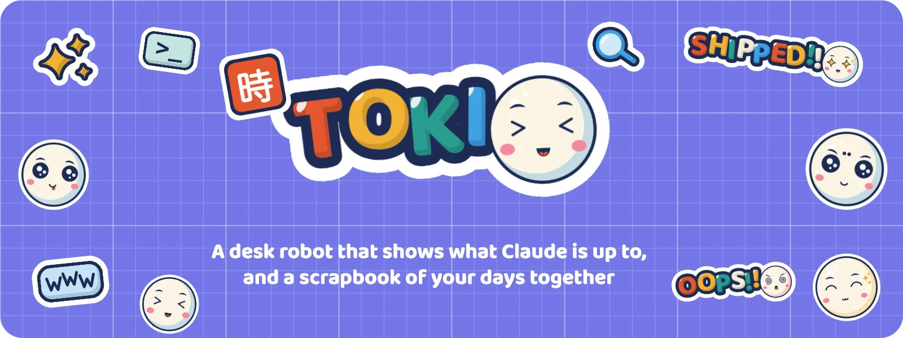
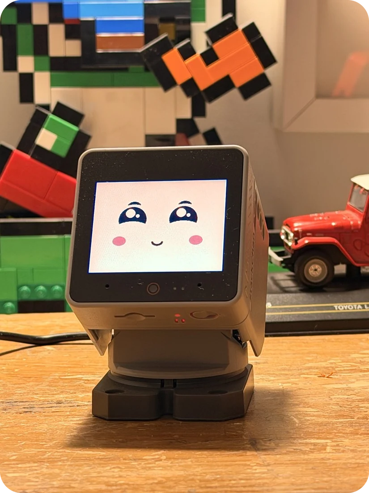
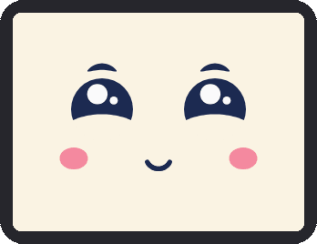
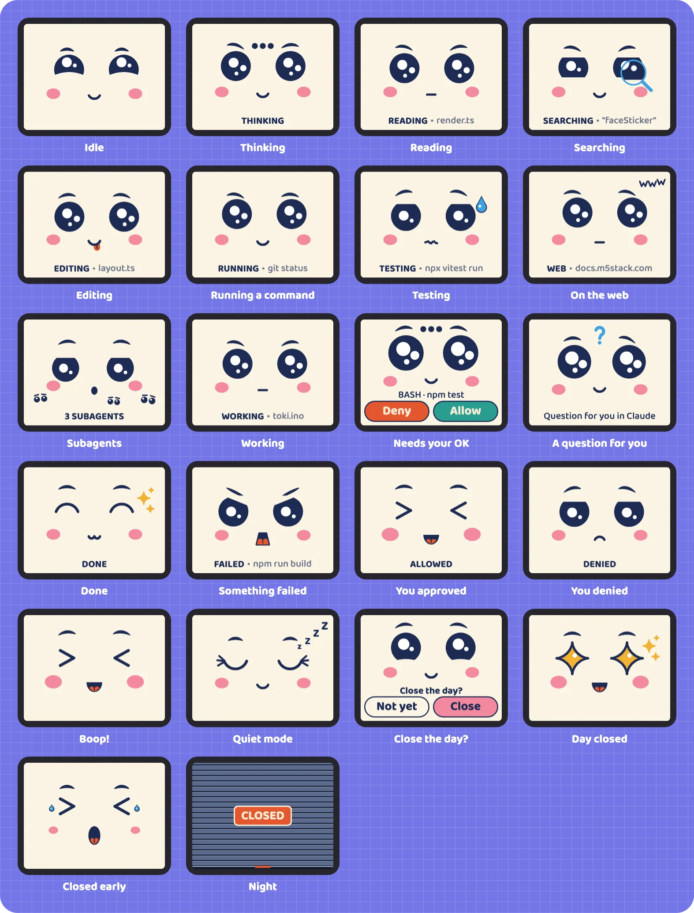
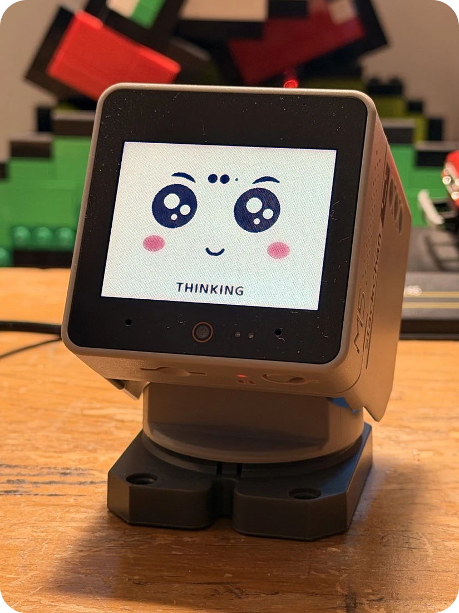
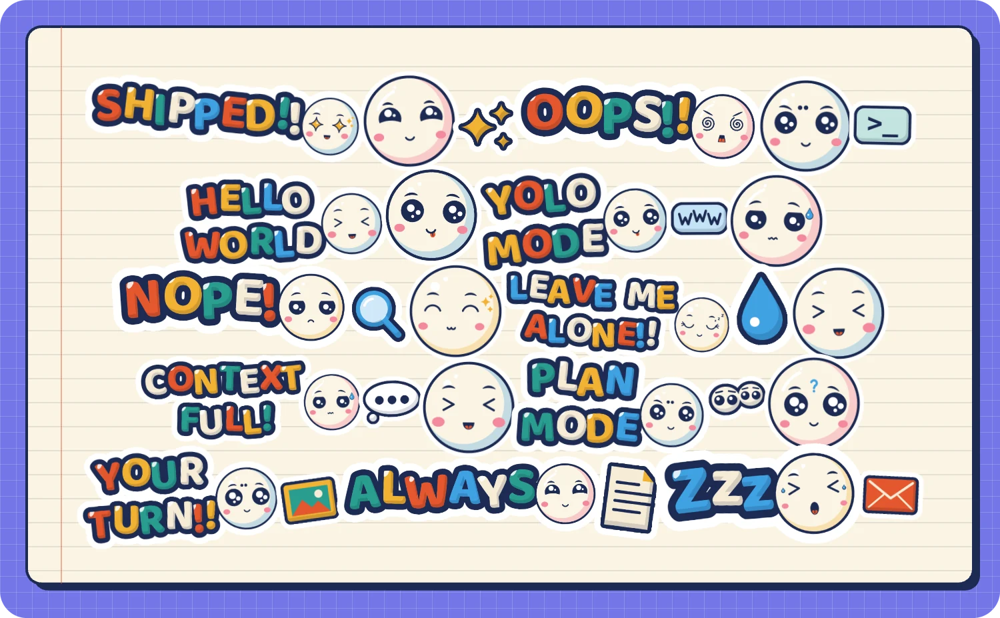
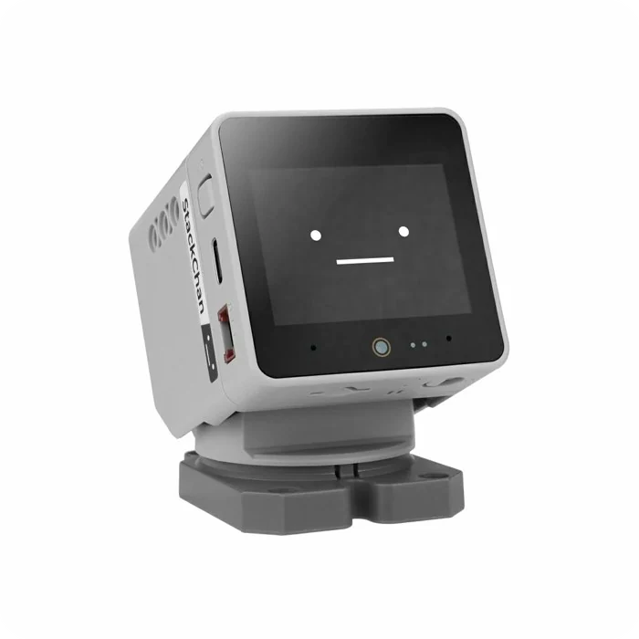
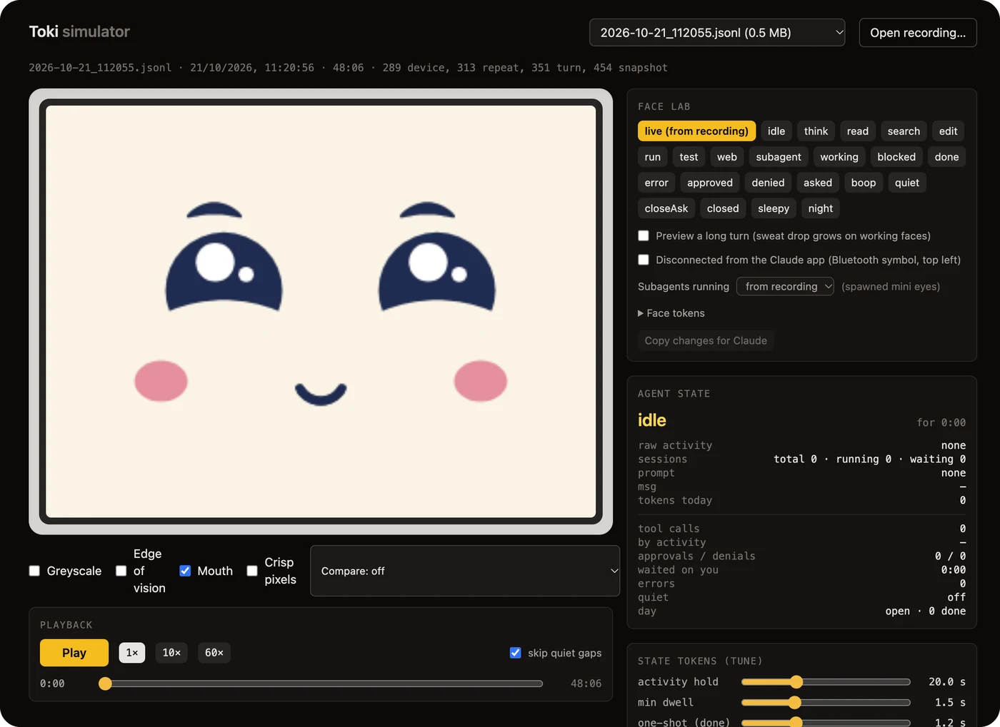
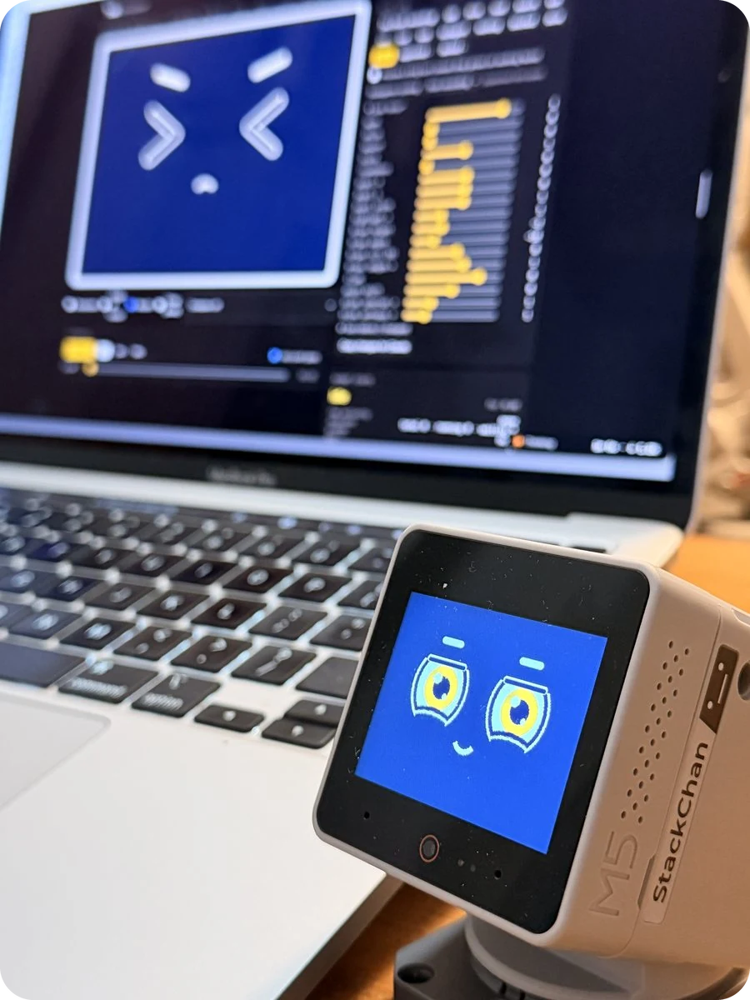

<h1 align="center"></h1>

<p align="center">
  
  &nbsp;
  
</p>

Toki lives on an [M5Stack StackChan](https://docs.m5stack.com/en/StackChan) (the K151, built on a CoreS3) and keeps an eye on Claude Code and the Claude desktop app. Its face changes with whatever Claude is doing: reading, running a command, searching the web, sweating over your tests. When Claude needs your OK, Toki looks up at you, glows amber, and you answer with a tap on its face. You don't even have to look: idle, busy and waiting each read differently from the corner of your eye.

*Toki* is Japanese for time, or a moment. It's also a pun on tokens.

<h2></h2>

<p align="center">
  
</p>

Every face is drawn live, so it blinks, glances about and breathes, and every one is triggered by something real. Nothing on the screen is random.

<h2></h2>



- **A face that follows Claude.** A kawaii face, drawn live on a cream screen: big shiny eyes, pink cheeks, a tongue when it concentrates. Each kind of work has its own expression and a small manga symbol: a magnifier for searching, a sweat drop for tests, "www" for the web, little faces for subagents. Under the face, a label says what Claude is working on (`READING · render.ts`), if you want it.
- **Approvals on the robot.** Allow or Deny on the touchscreen; hold Allow for "Always allow" when Claude offers a rule. Questions stay in Claude, where you can read them.
- **A body that only moves when it matters.** The servos are loud, so the head moves for interruptions only: it rises when Claude is waiting for you, nods when you approve, and wiggles when you close the day.
- **Your day, closed.** Long-press the face at the end of the day and a shop shutter comes down over Toki. Tap to open it again.
- **A scrapbook.** A sticker for everything you ask Claude, and more for the moments that matter. See below.

<br clear="right">

<h2></h2>

<p align="center">
  
</p>

A diary of your days with Claude, in stickers. It fills itself as you work. Each day is a notebook page: a sticker for every prompt, sized by how much work it took, and stickers of their own for the moments that matter (a push, an error, a long wait for your OK, the day you close). Zoom out to a month calendar, or the whole year as a quilt of Toki's faces. Your busiest days come out silver or gold, and rare moments holographic.

- **Where:** `http://localhost:4747`, while Toki's bridge runs (it starts when you log in). Or, in Terminal: `toki open`.
- **Its own window:** in Safari, File, then Add to Dock (macOS 14 or later). In Chrome, the install icon in the address bar.
- **Private:** it's served to your Mac only (127.0.0.1), from data in `~/StackChanData`. Nothing in it is ever uploaded, and nothing from it is ever published.

<h2></h2>



- An **M5Stack StackChan K151** and its USB-C cable. It arrives with a plain face; Toki gives it a new one (and `toki restore` puts the old one back).
- A **Mac** with [Homebrew](https://brew.sh).
- The **Claude desktop app** (for Bluetooth, through its Hardware Buddy) and **Claude Code**.
- **2.4 GHz Wi-Fi** that your Mac shares. The robot can't use 5 GHz.

<h2></h2>

```bash
brew install g1d30nB/toki/toki
toki setup
```

`toki setup` walks you through everything, one step at a time, in about 15 minutes. It explains what each step does and checks it worked before moving on. You can stop at any point and run it again: it skips whatever is already done.

1. Finds the robot over USB.
2. **Backs up the robot's factory firmware** to your Mac, before anything else. `toki restore` puts it back exactly as it came.
3. Puts Toki on the robot. Your Wi-Fi, settings and Bluetooth pairing survive updates.
4. Checks the head looks straight at you, and helps you set it if not.
5. Gives Toki your Wi-Fi (typed in your own Terminal; it's stored on the robot, never in a file).
6. Starts the bridge, a small background program that connects Claude, Toki and the scrapbook.
7. Connects Claude Code (shows you exactly what it adds to `~/.claude/settings.json`, and asks first).
8. Pairs with the Claude desktop app.
9. Introduces your scrapbook.

> On an Apple Silicon Mac with macOS 15 or later, Homebrew installs a ready-made package. On macOS 14 or an Intel Mac it builds Toki from source and first asks for Apple's Command Line Tools (`xcode-select --install`): that's Homebrew, not Toki, and it's a one-off.

## Day to day

```
toki status      how everything is: the bridge, the robot, Claude Code. Changes nothing.
toki open        the scrapbook and settings
toki calibrate   check the head looks straight at you, and set it if not
toki wifi        give Toki a different Wi-Fi network (over USB)
toki flash       put Toki's firmware on the robot again (over USB)
toki stop        stop the bridge (Toki carries on over Bluetooth)
toki restore     put the factory firmware back
```

**If the head stops moving** while the face carries on, its servos have switched themselves off (overload protection). Unplug the base, hold the power button on the left side for 6 seconds until the screen goes dark, wait 10 seconds and plug it back in.

**To remove Toki:** `toki stop && toki hooks uninstall`, then `brew uninstall toki`. `toki restore` first if you want the robot back as it came.

## How it works

```
Claude Code ──hooks──▶ bridge (on your Mac) ──Wi-Fi──▶ Toki
Claude app ──────────── Bluetooth (Hardware Buddy) ───▶ Toki
                       bridge ──▶ ~/StackChanData ──▶ scrapbook (localhost:4747)
```

- **The bridge** receives Claude Code's hooks, holds permission requests until you answer on Toki, keeps the diary, and serves the scrapbook. It's Node, with no dependencies, and runs as a login agent.
- **The robot** runs its own Arduino firmware: the face, touch, servos and LEDs, plus a copy of the state logic so it still works over Bluetooth when the bridge is off.
- **The face is designed in a browser simulator first,** and the robot's face data is generated from it, so the two never drift apart.

<p align="center">
  
</p>



**How it started.** The first face on the glass (3 October), beside the simulator it was designed in: dark blue, ringed amber eyes, a tiny smile. It went kawaii three weeks later, after four rounds of review on the robot itself.

<br clear="right">

| Folder | What |
|---|---|
| `firmware/toki/` | the robot's firmware (Arduino, StackChan-BSP / M5Unified) |
| `firmware/fonts/` | Baloo 2 and the script that turns it into the robot's smooth fonts |
| `bridge/` | the Mac service and the `toki` command |
| `simulator/` | the face lab and the scrapbook (Vite, React, TypeScript) |
| `art/` | the first, generated sticker art and its tools (the stickers are drawn in code now) |
| `docs/` | the design spec, the bridge and setup designs, restoring the factory firmware, and the images on this page |
| `packaging/` | the release build and the Homebrew formula |

## Building from source

You'll need Node 24, Python 3 and `arduino-cli` with the ESP32 core 3.3.11, plus these Arduino libraries: [StackChan-BSP](https://github.com/m5stack/StackChan-BSP) from GitHub (`main` at `8d4d6fc`; the version in the Arduino index is older and doesn't compile), M5Unified 0.2.24, M5GFX 0.2.31 and ArduinoJson 7.4.3.

```bash
npm --prefix simulator install
npm --prefix simulator run dev              # the face lab, on http://localhost:5174
npm --prefix simulator test
npm --prefix bridge start                   # the bridge, in the foreground
arduino-cli compile firmware/toki --build-property "compiler.cpp.extra_flags=-DTOKI_NO_SECRETS"
node packaging/build-release.ts             # a release tarball and its Homebrew formula
```

The board settings are in `firmware/toki/sketch.yaml` (pass `-p` with your robot's port to upload); the design rationale is in [docs/behaviour-spec.md](docs/behaviour-spec.md).

## Caveat

Hardware Buddy, in the Claude desktop app, is an unofficial developer feature. Its protocol may change and break the Bluetooth half of Toki; the Wi-Fi half (Claude Code's hooks) doesn't depend on it.

## Licences and thanks

- **Code:** MIT, see [LICENSE](LICENSE).
- **Art:** all rights reserved, see [art/LICENSE](art/LICENSE). It ships with the repo so Toki works out of the box, but it may not be reused, remixed or sold.
- **Images:** the faces and stickers in `docs/images` are Toki's art (all rights reserved, as above); the StackChan photo is M5Stack's.
- **Baloo 2** by the Baloo 2 Project Authors, SIL Open Font License 1.1 ([firmware/fonts/OFL.txt](firmware/fonts/OFL.txt)).
- Built on [StackChan-BSP](https://github.com/m5stack/StackChan-BSP), M5Unified and M5GFX by M5Stack, and Anthropic's [claude-desktop-buddy](https://github.com/anthropics/claude-desktop-buddy) (MIT). The hook relay was informed by [Coucou](https://github.com/Louis-CFM/coucou).

Made by [Gideon Bullock](https://gideonb.me).
